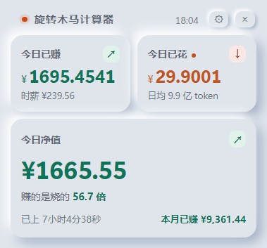

# 旋转木马计算器

把你的**工资**和 **AI token 消耗**放在同一个屏幕上看。

上班的时候，时间在变成钱；同时，AI 在花你的钱。
这个小工具把两个数字并排摆出来，让你一眼看到今天净赚多少。



## 它显示什么

| 位置 | 内容 |
|---|---|
| 左上 | **今日已赚** —— 按上下班时间自动累计，精确到秒 |
| 右上 | **今日已花** —— token 按「月总额 → 日均 → 每秒」推算 |
| 下方 | **今日净值** —— 赚减花，以及「赚的是烧的多少倍」 |
| 底行 | 已上工时（时:分:秒）+ 本月已赚 |

赚钱是绿色，花钱是橘色。

## 下载

到 [Releases](../../releases) 下载：

- **免安装版** `CarouselCalculator-*-portable.exe` —— 双击就跑，不写注册表
- **安装版** `CarouselCalculator-*-setup.exe` —— 会建开始菜单快捷方式

只支持 Windows x64。

## 三个特点

- **不联网**。所有计算在本地完成，没有任何请求发出。
- **不登录**。没有账号，没有云端。
- **数据留在本机**。配置存在 `%APPDATA%\carousel-calculator`。

## 计算口径（重要，别误解）

**工资**

```
月工作天数 = (7 − 每周休息天数) ÷ 7 × 30.44
日薪       = 月薪 ÷ 月工作天数
每秒工资   = 日薪 ÷ (每日工时 − 午休) ÷ 3600
```

每日工时由上班/下班时间算出，午休从上班一小时后开始扣。
**按时间自动累计，不需要打卡。**

**token**

```
日均 = 本月 token 总额 ÷ 本月已过天数
每秒 = 日均 ÷ 86400
金额 = 每秒 × token 单价 ÷ 1000000
```

**本月已赚** = 已过工作日 × 日薪 + 今天已赚

## 开发

```bash
cd electron
npm install
npm start          # 开发运行
npm run dist       # 打包 Windows 免安装 + 安装版
```

源码结构：

```
electron/
  main.js           主进程：窗口、位置记忆、IPC
  preload.js        上下文桥
  renderer/
    index.html      全部 UI + 逻辑（单文件，无框架）
  build/icon.ico
```

## 许可

MIT
